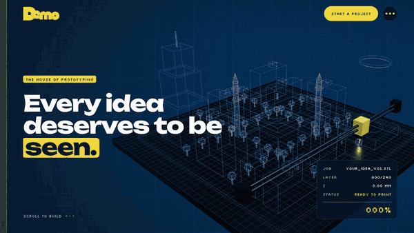

# Scrollytelling Brand Site — a Claude skill

> Teach Claude to build **award-level, scroll-told company websites**: a story driven by scroll, a WebGL
> "layer by layer" print scene, pinned 3D models per service, a projects gallery, and an optional CMS —
> fast enough to idle at ~0% CPU on a phone.

<p align="center">
  
  <br><sub>▶ <a href="https://github.com/abdelrhman2007/scrollytelling-brand-site/releases/latest">Full-quality video (MP4) in the latest release</a></sub>
</p>

| | |
|---|---|
|  |  |
|  |  |

<p align="center">
  
  
  
</p>

*Screenshots are from the real reference build. See the full gallery in
[`references/gallery.md`](skills/scrollytelling-brand-site/references/gallery.md).*

## What Claude learns from this skill

- **A workflow**: discover the brand's metaphor → scaffold a tested kernel → build the story as beats → add pages →
  optional CMS → measure and optimise → responsive QA → ship with honest, measured results.
- **Architecture**: Next.js 15 · React 19 · TypeScript · GSAP ScrollTrigger · Lenis · React Three Fiber, organised as
  **HMVC modules** (model / controller / view per section) with a small shared kernel.
- **A catalogue of scroll beats**: printing preloader, pinned hero with phases, kinetic statements, split panels,
  horizontal tracks, a pinned per-service 3D sequence, six case-study effects, marquees, scan-line portraits, finale.
- **3D that stays light**: a clip-plane "print kit", baking hundreds of parts into one draw, render-on-demand,
  near-viewport mounting, adaptive pixel density, aspect-aware framing.
- **Performance with numbers**: budgets and copy-paste measurement scripts (draw calls, idle CPU, frame timing,
  heap) plus the fixes that took a real site from 637 to 17 draw calls and from 6% to 0.6% idle CPU.
- **Responsive QA**: an automated audit at 7 sizes and the rules that came out of it.
- **Optional .NET 10 CMS**: Clean Architecture, Blazor + MudBlazor admin, EF Core on SQL Server, contact inbox,
  media library, roles, and **private QR contact cards** at addresses like `/qr`.
- **Templates**: 60+ real, tested files from the build to start from.

## Install

### Option A — Claude Code plugin (recommended)

```text
/plugin marketplace add abdelrhman2007/scrollytelling-brand-site
/plugin install scrollytelling-brand-site@scrollytelling-brand-site
```

### Option B — copy the skill folder

```bash
git clone https://github.com/abdelrhman2007/scrollytelling-brand-site.git
cp -R scrollytelling-brand-site/skills/scrollytelling-brand-site ~/.claude/skills/
```

For a single project instead of your whole machine, copy it into `<project>/.claude/skills/`.

## Use it

Just ask — the skill triggers on requests like:

- *"Build a premium scrollytelling website for our architecture studio. Here is our company profile PDF."*
- *"Make an Awwwards-style 3D website for a furniture brand, with a CMS the team can edit."*
- *"I want a site like the House of Prototyping one, for my bakery."*

Or name it directly: *"Use the scrollytelling-brand-site skill to…"*

## Repository layout

```
.
├─ .claude-plugin/
│  ├─ plugin.json            plugin manifest
│  └─ marketplace.json       lets people install straight from this repo
├─ skills/scrollytelling-brand-site/
│  ├─ SKILL.md               the entry point Claude reads first
│  ├─ references/            loaded on demand (architecture, choreography, 3D, performance, QA, CMS, gallery)
│  └─ assets/
│     ├─ screenshots/        the quality bar (15 images)
│     └─ templates/          copy-ready kernel files and example modules
├─ docs/demo.gif            the animated preview above
├─ .github/                 issue & pull-request templates
├─ CHANGELOG.md · CONTRIBUTING.md · CODE_OF_CONDUCT.md · LICENSE · NOTICE.md
```

## Requirements

- Claude Code (CLI, desktop or web) or any client that supports Agent Skills.
- For the projects it builds: Node.js 20+; optionally .NET 10 SDK and Docker (SQL Server) for the CMS.

## Privacy

This repository contains no personal data. Real names and phone numbers in the screenshots are pixelated, and all
examples use fictional people and `example.com`. If you spot anything, please open an issue.

## Contributing

Ideas, fixes and techniques from your own builds are welcome — see [CONTRIBUTING.md](CONTRIBUTING.md). Questions and
show-and-tell go in [Discussions](https://github.com/abdelrhman2007/scrollytelling-brand-site/discussions).

## License

Code and docs: [MIT](LICENSE). The brand and photographs visible in the screenshots are **not** covered — see
[NOTICE.md](NOTICE.md).
