# Reference gallery: Demo, The House of Prototyping

These are production-build screenshots of the finished site. Use them as the quality bar: real brand colours, huge display type, one signature highlight, a blueprint grid, generous spacing, and 3D that serves the story.

| Screenshot | What it demonstrates |
|---|---|
| 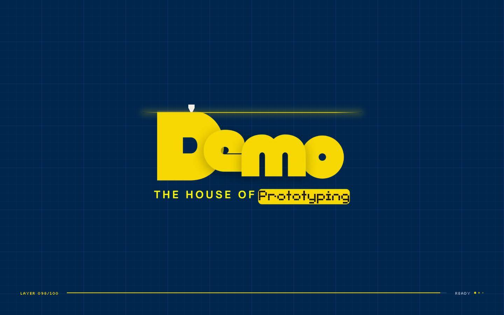 `01-preloader` | **Brand-moment preloader.** The logo "prints" bottom-up behind a glowing print-head line, with a `LAYER 000/100` counter and status lines ("Slicing idea", "Heating nozzle"). It has a 1.6 s minimum and plays once per visit, on Home only. |
| 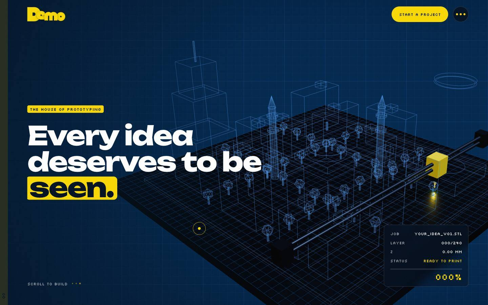 `02-hero-blueprint` | **Pinned WebGL hero, phase 1.** The model starts as a blueprint wireframe ghost. The headline uses `SplitWords` with a `[[seen.]]` highlight box, and a live printer HUD (job, layer, Z, status, %) sits bottom-right. |
| 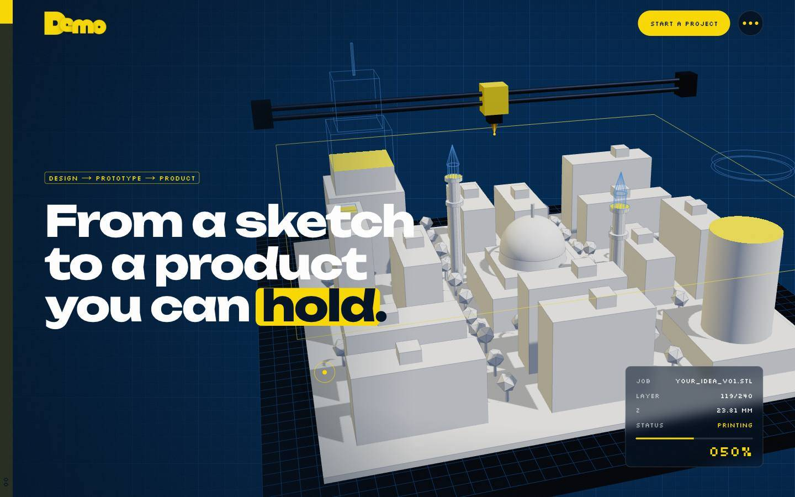 `03-hero-printing` | **Scroll prints the model.** A clip plane rises: solid below, yellow molten cap at the cut, wireframe above. The gantry and nozzle follow the layer, and the copy switches to phase 2. |
| 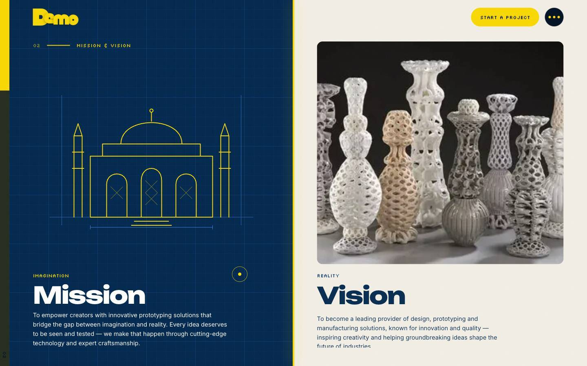 `04-mission` | **Split panels close a gap.** "Imagination" (navy, an SVG sketch drawing itself) and "Reality" (paper, a photo clip-reveal) slide together; a yellow seam grows between them. |
| 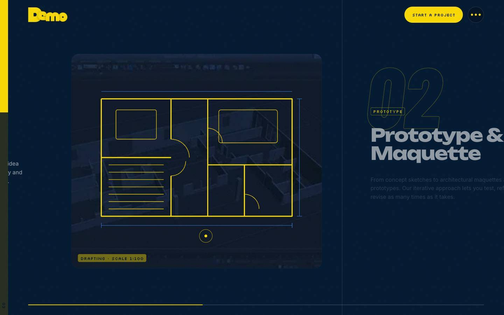 `05-process-horizontal` | **Horizontal track inside a pin.** Each panel has its own effects driven by `containerAnimation`: a floor plan drafting itself, a sketch wiping into the model, a vase printing. Huge outlined numerals sit behind the titles. |
| 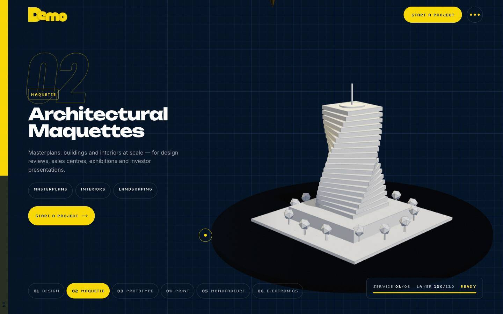 `06-services-3d` | **Pinned per-service 3D sequence.** Each service prints its own procedural model; copy crossfades; a numbered rail lets you jump; a HUD shows service, layer and status. Only one model is drawn at a time (~4 draw calls). |
| 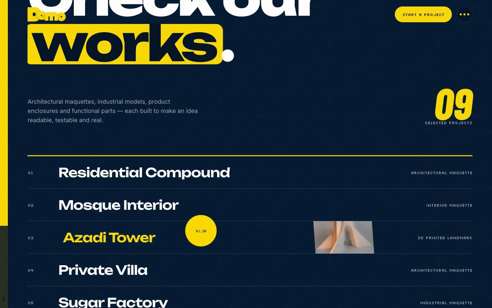 `07-works-teaser` | **Home teaser for projects.** A giant title, a "table of contents" index with hover thumbnails, a project count, and "See all projects" leading to `/works`. |
| 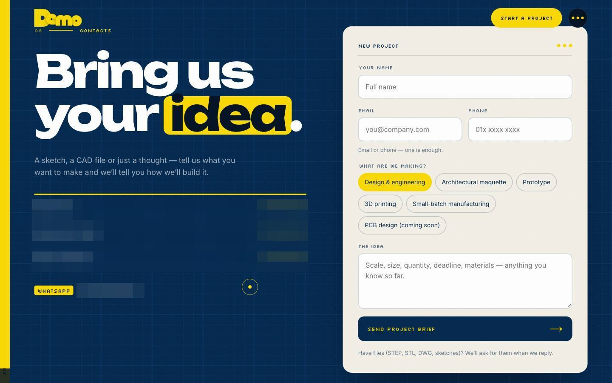 `08-contact` | **"New project" form on paper.** Type chips, email-or-phone rule, honeypot; sending / sent / error states; WhatsApp fallback. Direct numbers sit on the left. |
| 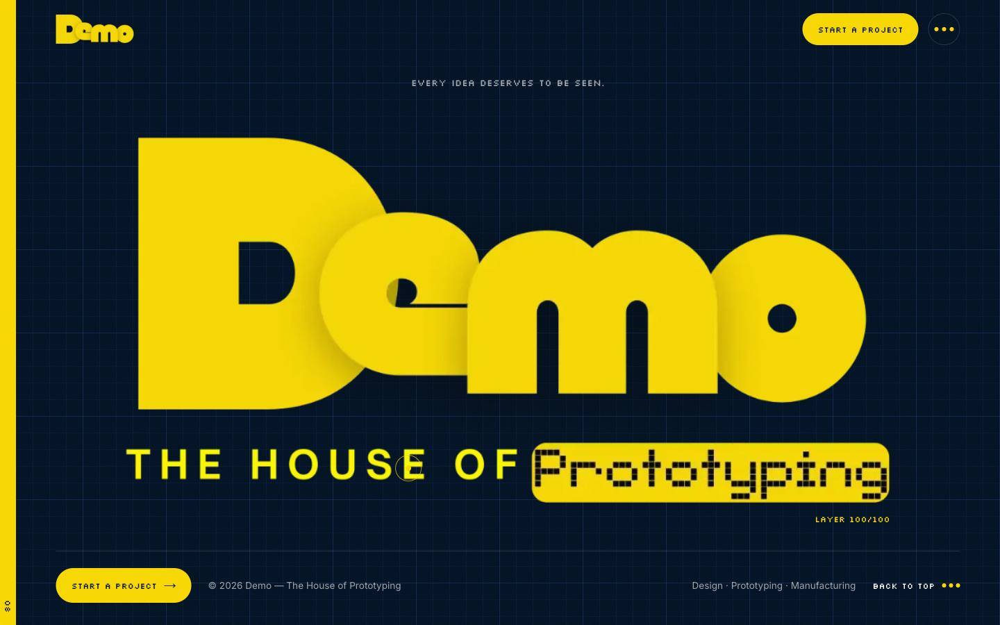 `09-finale` | **Bookend.** The logo prints one last time to `LAYER 100/100`; CTA, credits and back-to-top follow. |
| 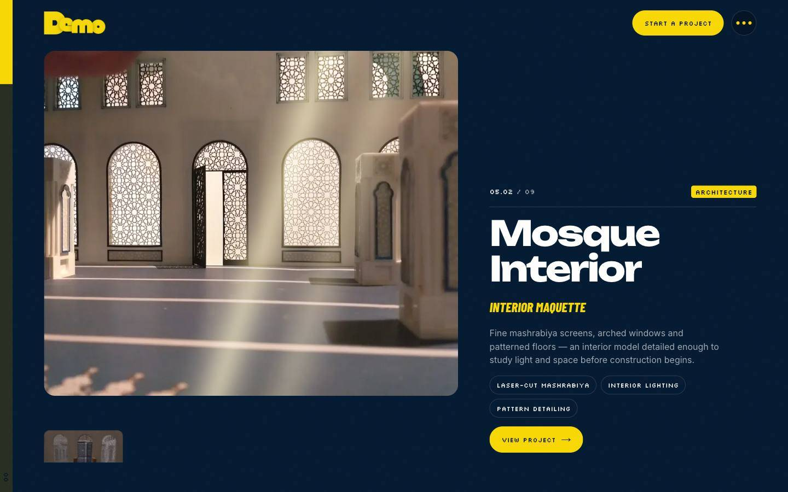 `10-case-study` | **Case study with its own scroll effect** (here "light": daylight sweeps through mashrabiya). Other effects: zoom, turn (turntable), wipe (plan → model), pan, stack (exploded fan). There are themed backgrounds (navy, paper, yellow), and the header changes contrast to match. |
| 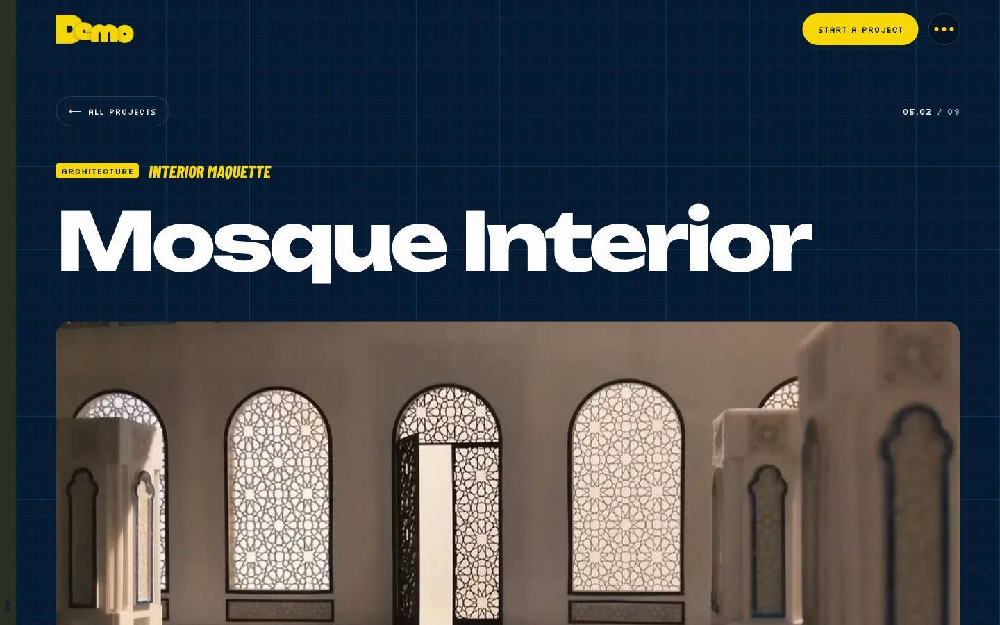 `11-project-page` | **Project detail page** `/works/[slug]`: tags, title, hero, overview, then a gallery with an accessible lightbox and previous/next links. |
| 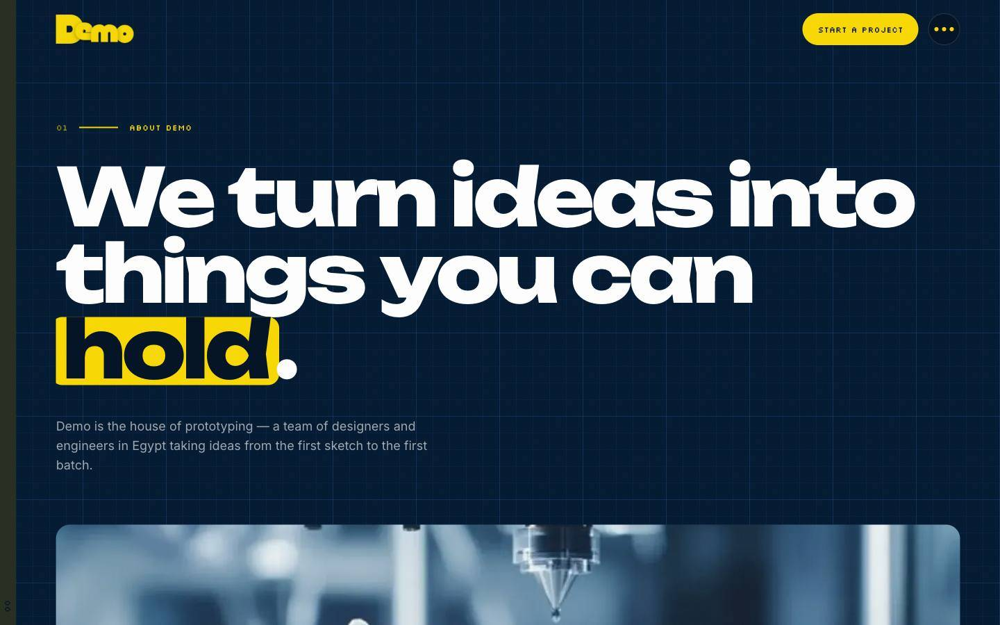 `12-about` | **About page** built from small modules: page hero, story, mission, approach, values, team, CTA. |
| 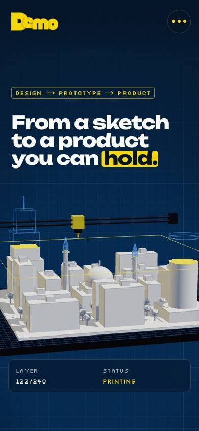 `13-mobile-hero` | **Phone hero.** The headline stays clear because the model is framed lower via `setViewOffset`; the HUD is reduced to Layer + Status on screens ≤ 400 px. |
| 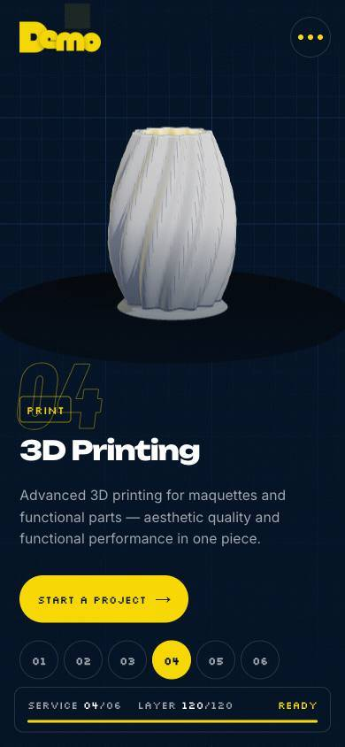 `14-mobile-services` | **Phone services.** The model sits above the copy, the camera distance is fitted to the narrow field of view, and the rail becomes number chips. |
| 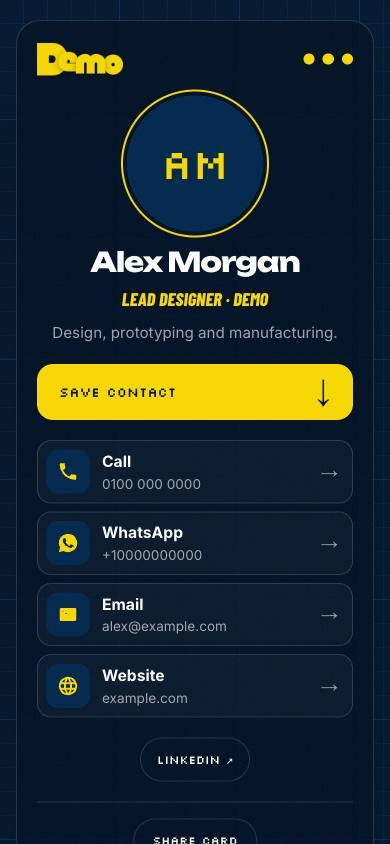 `15-contact-card` | **Private QR contact card** at a root address (`/qr`). Save contact (.vcf), Call, WhatsApp, Email, Website, Share. It is noindex, never linked and never cached. |
